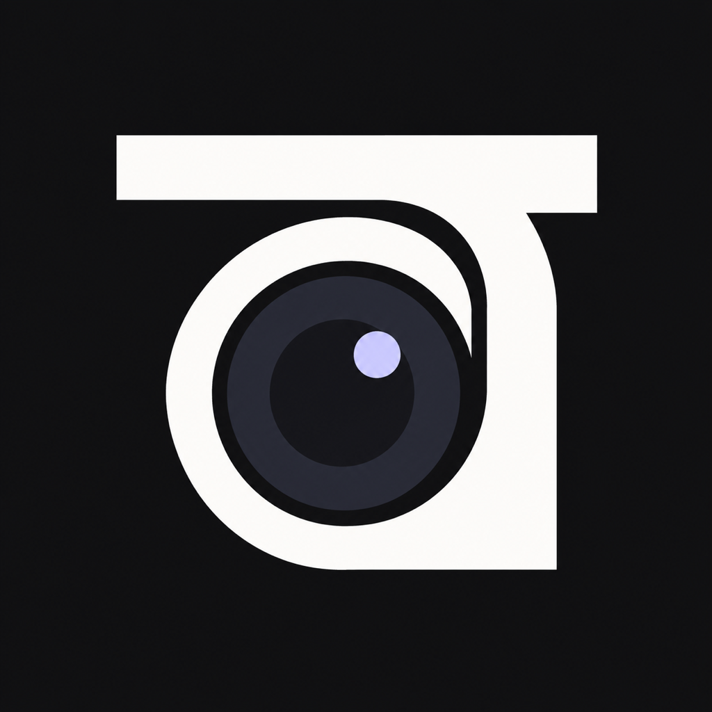

<p align="center">
  
</p>

<h1 align="center">TypeCam</h1>

<p align="center">
  Turn your iPhone into a low-latency, wired camera for <b>OBS Studio</b> on macOS.
</p>

<p align="center">
  <a href="https://apps.apple.com/us/app/typecam-obs-camera/id6821537950">App Store</a> ·
  <a href="https://monawwar.com/apps/typecam">Website</a> ·
  <a href="docs/ARCHITECTURE.md">Architecture</a> ·
  <a href="docs/ROADMAP.md">Roadmap</a> ·
  <a href="CONTRIBUTING.md">Contributing</a>
</p>

<p align="center">
  
  
  
  <a href="https://apps.apple.com/us/app/typecam-obs-camera/id6821537950"></a>
  <a href="LICENSE"></a>
</p>

---

Plug your iPhone into your Mac, open TypeCam, and add a **TypeCam (iPhone)** source in OBS. The phone
hardware-encodes video and audio and sends it down the cable. No Wi-Fi, no network setup, no pairing beyond
*Trust This Computer*.

<p align="center">
  <a href="https://apps.apple.com/us/app/typecam-obs-camera/id6821537950"><b>Download TypeCam on the App Store</b></a>
</p>

## Features

- **Wired** — streams over Apple's `usbmuxd` USB tunnel (the same link Xcode uses). Nothing touches your network.
- **Low latency** — real-time H.264 or HEVC with no B-frames. Target is under 100 ms glass-to-OBS at 1080p60.
- **Up to 4K60** — 720p, 1080p or 4K at 24–60 fps, auto or manual bitrate.
- **Pro camera controls** — every physical lens, manual focus, ISO, shutter, EV, AE/AF lock and WB lock on a
  bottom control deck with ruler dials.
- **Audio** — mic audio in sync with video, as PCM (lowest latency) or AAC, with gain, presets and a low-cut filter.
- **Assist overlays** — grid, level, histogram, zebra and focus peaking. Preview only, never in the stream.
- **Multi-camera** — two iPhones can be two independent OBS sources.
- **No dependencies** — Apple frameworks on iOS, plain C + VideoToolbox in the plugin.

TypeCam is a **streaming camera, not a camera app**: no photo or video modes, no gallery, no local recording.

## How it works

```
 iPhone                                         Mac
┌──────────────────────────────┐            ┌──────────────────────────────┐
│ Camera + mic                 │            │ OBS Studio                   │
│   └─► VideoToolbox encode    │    USB     │   └─ TypeCam source          │
│         └─► TCP :7878  ══════╪═ usbmuxd ══╪══►    VideoToolbox decode    │
│             (loopback only)  │   tunnel   │       └─► OBS video + audio  │
└──────────────────────────────┘            └──────────────────────────────┘
```

The phone is the server: it listens on loopback port `7878`. The plugin asks `usbmuxd` to open a connection to
that port on the attached device, then speaks a small framed binary protocol over it. See
[ARCHITECTURE.md](docs/ARCHITECTURE.md) and [PROTOCOL.md](docs/PROTOCOL.md) for the details.

## Repository layout

| Path | What | Tech |
|---|---|---|
| [`ios/`](ios/) | iPhone camera app | Swift, SwiftUI, AVFoundation, VideoToolbox, Network.framework, Metal — iOS 18+ |
| [`obs-plugin/`](obs-plugin/) | OBS source plugin (`obs-typecam`) | C, CMake, libobs, VideoToolbox — macOS 13+, OBS 31+ |
| [`docs/`](docs/) | Specs: architecture, wire protocol, app, plugin, roadmap | Markdown |

## Requirements

- iPhone on **iOS 18** or later
- Mac on **macOS 13** or later with **OBS Studio 31** or later
- A USB-C or Lightning cable

To build the plugin (or the app) from source you also need the latest **Xcode** and **CMake 3.28+**.

## Getting started

### 1. Install the iOS app

Get **[TypeCam – OBS Camera](https://apps.apple.com/us/app/typecam-obs-camera/id6821537950)** from the App Store and install it on your iPhone.

<details>
<summary>Or build the app from source</summary>

```sh
git clone https://github.com/mxvsh/TypeCam.git
cd TypeCam
```

Signing is kept out of the project file, so set up your own team and bundle ID once:

```sh
cp ios/Config/Local.xcconfig.example ios/Config/Local.xcconfig
```

Edit `ios/Config/Local.xcconfig` and set `DEVELOPMENT_TEAM` to your Apple team ID and `BUNDLE_ID_PREFIX` to a
reverse-DNS prefix you own (the app becomes `<prefix>.TypeCam`). A free Apple account works for running on your
own phone. This file is git-ignored, so your values never end up in a commit.

Then open the project, pick your iPhone and press **Run**:

```sh
open ios/TypeCam.xcodeproj
```

</details>

### 2. Build and install the OBS plugin

The OBS plugin isn't distributed as an installer yet, so build it from source:

```sh
cd obs-plugin
cmake --preset macos          # first run downloads OBS sources and obs-deps into .deps/ (takes a few minutes)
cmake --build --preset macos
```

Quit OBS, then install the plugin for your user:

```sh
rm -rf ~/Library/Application\ Support/obs-studio/plugins/obs-typecam.plugin
cp -R build_macos/RelWithDebInfo/obs-typecam.plugin \
  ~/Library/Application\ Support/obs-studio/plugins/
```

To build an App Store IPA, run `scripts/release.sh` (see [Releasing](CONTRIBUTING.md#releasing-the-ios-app)).

### 3. Stream

1. Connect the iPhone to your Mac with a cable and tap **Trust** if asked.
2. Open TypeCam on the phone and keep it in the foreground.
3. In OBS, add a source → **TypeCam (iPhone)** and pick your phone.

The source's **Status** line shows the resolution, frame rate, codec and estimated latency once it's live.

## Status

TypeCam 1.0 is out on the App Store and works end to end over USB (video, audio, pro controls and overlays). A
signed, notarized plugin installer is still to come. Windows and Linux plugin builds, Wi-Fi fallback and controlling
the phone from OBS are planned for v2. See [ROADMAP.md](docs/ROADMAP.md).

## Contributing

Contributions are welcome — bug reports, testing on different iPhones and Macs, and code. Please read
[CONTRIBUTING.md](CONTRIBUTING.md) first; in particular, any change to the wire protocol must update the spec,
the app and the plugin together.

## License

TypeCam is released under the [MIT License](LICENSE).

## Acknowledgements

The plugin is built on the official [obs-plugintemplate](https://github.com/obsproject/obs-plugintemplate).

## Author

Built by [Monawwar Abdullah](https://monawwar.com) ([@monawwarx](https://x.com/monawwarx)).
